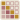
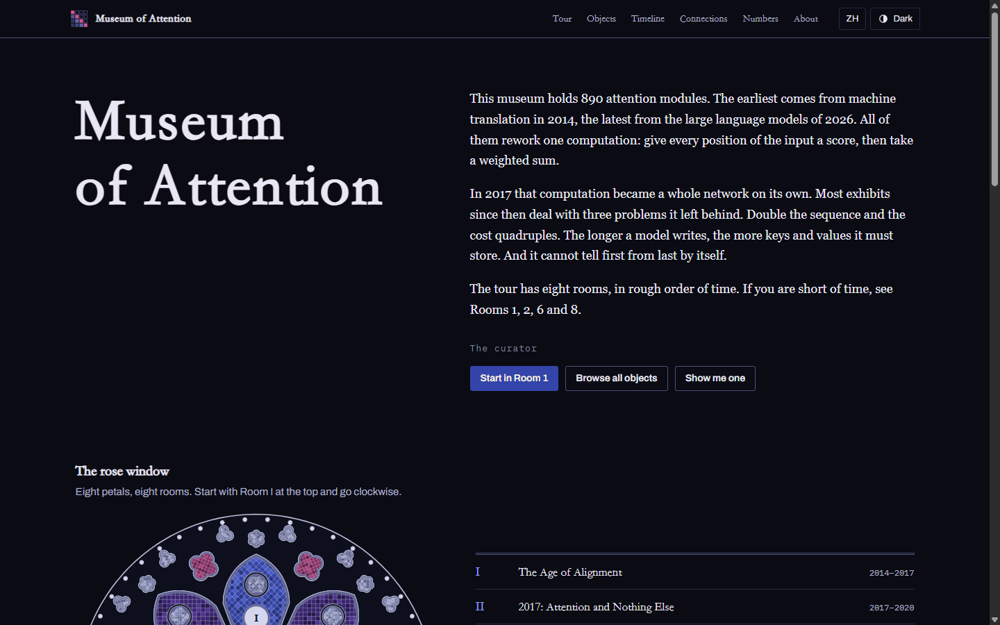
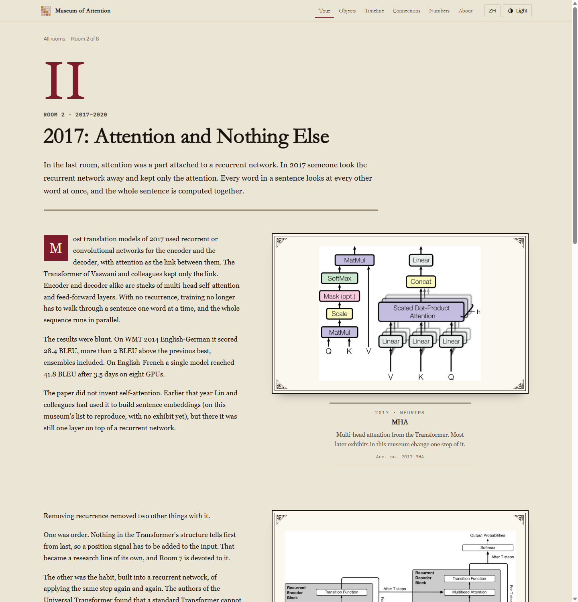
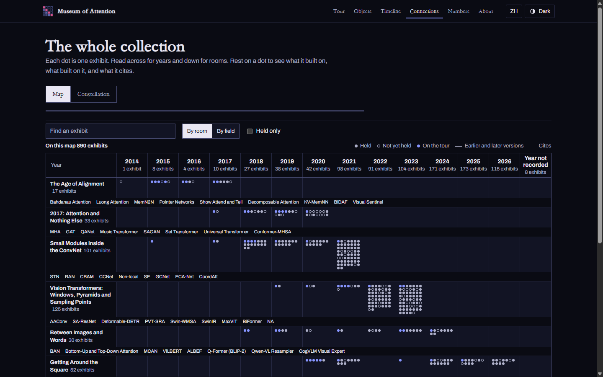

<div align="center">



# Museum of Attention

**A walk through the history of attention modules, 2013–2026.**

[Visit the museum](https://attention.chenmingkun.cn) · [简体中文](README.zh-CN.md)



</div>

## What this is

A static website that presents a personal library of attention modules as a museum. The collection holds 890 modules, and it grows as the library grows. Each exhibit has a label with the paper's own figure, a short introduction in Chinese and English, links to the paper and the code, and the earlier and later work it connects to.

The centre of the site is a guided tour in eight rooms. It tells how one computation, a score for every position followed by a weighted sum, went from a patch on a translation model in 2014 to the whole network in 2017, and what the field has done about its costs since then.

## What you can do there

| Page | What it shows |
|---|---|
| **Tour** | Eight rooms in order of time. Each wall text names the exhibits it talks about. |
| **Objects** | Every exhibit, filtered by field, collection sweep, venue or year. |
| **Timeline** | The collection year by year. |
| **Connections** | A flat map of the whole collection and a 3D constellation of shared venues, repositories and years. |
| **Numbers** | Counts by field, year, code source and licence. |
| **About** | How the labels are made, where the code comes from, and how to ask for a figure to be removed. |

The site has a light theme and a dark theme, and every page works in Chinese and English.

<div align="center">


</div>

## Run it locally

The site is plain HTML, CSS and JavaScript. It needs no build step and requests nothing from other domains.

```bash
git clone https://github.com/oscar030406/museum-of-attention.git
cd museum-of-attention
python -m http.server 8780 -d site
```

Then open <http://localhost:8780>.

## How it is built

```
site/            the website: pages, styles, scripts, data, paper figures
curation/        the curator's layer: tour text, introductions, figure list
build_data.py    builds site/data/ from the module library and curation/
check.py         rebuilds the data and runs every check
make_rose.py     draws the rose window on the home page from Gothic tracery geometry
make_ornaments.py  draws the emblem and frame ornaments
fetch_figures.py   fetches each paper's architecture figure from arXiv
```

`build_data.py` reads a module library that is not part of this repository, so the data in `site/data/` is checked in as built. The maintenance notes are in [docs/MAINTAINING.zh-CN.md](docs/MAINTAINING.zh-CN.md) (Chinese).

## Figures and licences

- **Code**: MIT, see [LICENSE](LICENSE).
- **Tour text and exhibit introductions**: CC BY 4.0, see [LICENSE-CONTENT.md](LICENSE-CONTENT.md).
- **Paper figures**: they belong to their authors. The museum shows each one as a quotation, with its figure number and a link to the paper. If you are an author and would prefer your figure not to appear here, write to <oscar353012@gmail.com> and it will be taken down.
- **Ornaments**: the corner leaves and foliage bands come from A. C. Pugin's *Gothic Ornaments* (1854), in the public domain.

## Contributing

Corrections are welcome: a wrong year, a mislabelled module, an introduction that misreads the paper, a missing landmark. Open an issue and name the exhibit by its accession number, which is printed on every label.
