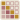
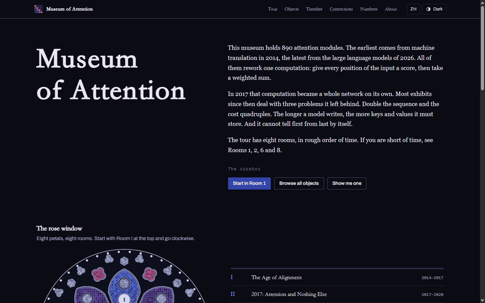
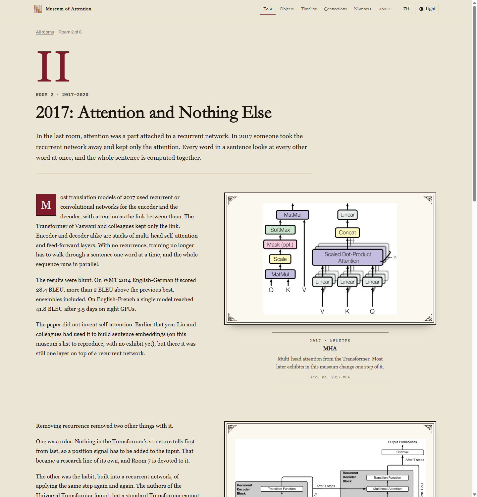
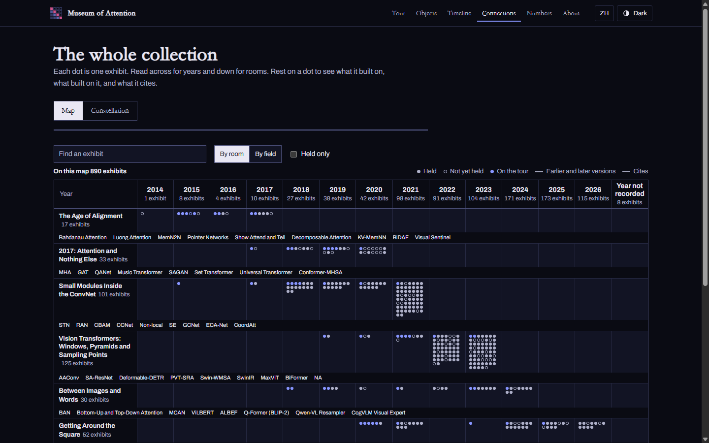

<div align="center">



# 注意力博物馆

**从 2013 年到 2026 年，把注意力模块的历史走一遍。**

[进馆参观](https://attention.chenmingkun.cn) · [English](README.md)



</div>

## 这是什么

一个静态网站，把个人收藏的注意力模块办成一座博物馆。馆里有 1200 多个模块，收藏库扩充时馆藏跟着增加。每件展品有一张展签：论文里的结构图，一段中英文简介，论文和代码的链接，以及它的前作和后作。

网站的主线是分八个展室的导览。它讲的是同一个计算的经历：给每个位置打一个分，再加权求和。2014 年它是翻译模型上的一个补丁，2017 年它自己成了整个网络，此后的工作大多在收拾它留下的代价。

## 馆里有什么

| 页面 | 内容 |
|---|---|
| **导览** | 八个展室，按年代排。每段展墙文字都点出它讲到的展品。 |
| **展品** | 全部展品，可以按领域、收集方向、发表地点和年份筛选。 |
| **时间线** | 逐年看馆藏。 |
| **关系图** | 一张平面总图，和一个由共同的出处、仓库、年份连成的 3D 星团。 |
| **统计** | 按领域、年份、代码来源和许可证计数。 |
| **关于** | 展签怎么写成，代码从哪来，以及怎样要求撤下一张图。 |

网站有浅色和深色两套主题，每一页都有中文和英文。

<div align="center">


</div>

## 在本机打开

网站只有 HTML、CSS 和 JavaScript，没有构建步骤，运行时不请求别的域名。

```bash
git clone https://github.com/oscar030406/museum-of-attention.git
cd museum-of-attention
python -m http.server 8780 -d site
```

然后打开 <http://localhost:8780>。

## 仓库里有什么

```
site/              网站：页面、样式、脚本、数据、论文图
curation/          馆长手写层：导览稿、简介、论文图清单
build_data.py      从模块库和 curation/ 生成 site/data/
check.py           重新生成数据并跑全部检查
make_rose.py       按哥特花格的作图法画首页的玫瑰窗
make_ornaments.py  画馆徽和画框纹样
fetch_figures.py   从 arXiv 取每篇论文的结构图
```

`build_data.py` 读的模块库不在这个仓库里，所以 `site/data/` 里的数据是生成后直接入库的。维护手册在 [docs/MAINTAINING.zh-CN.md](docs/MAINTAINING.zh-CN.md)。

## 图和许可

- **代码**：MIT，见 [LICENSE](LICENSE)。
- **导览稿和展品简介**：CC BY 4.0，见 [LICENSE-CONTENT.md](LICENSE-CONTENT.md)。
- **论文图**：版权归原作者。馆里把每张图当作介绍论文时的引用，写明论文里的图号并链接到原文。如果你是作者，不愿意自己的图出现在这里，请写信到 <oscar353012@gmail.com>，我会撤下。
- **纹样**：画框的角花和花叶带出自 A. C. Pugin 的《哥特纹样》（1854 年版），已进入公有领域。

## 参与

欢迎指出错误：年份不对，模块归错了类，简介读错了论文，漏了哪件里程碑。请开一个 issue，并写上展品的馆藏号，它印在每张展签上。
